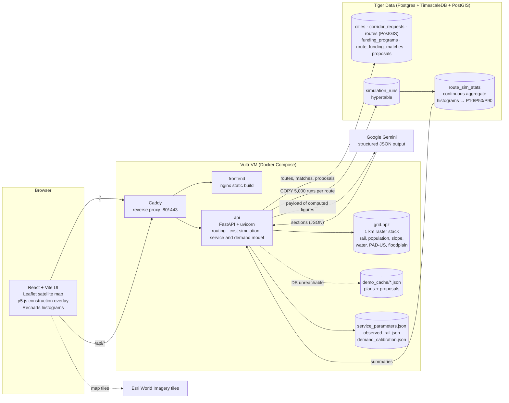
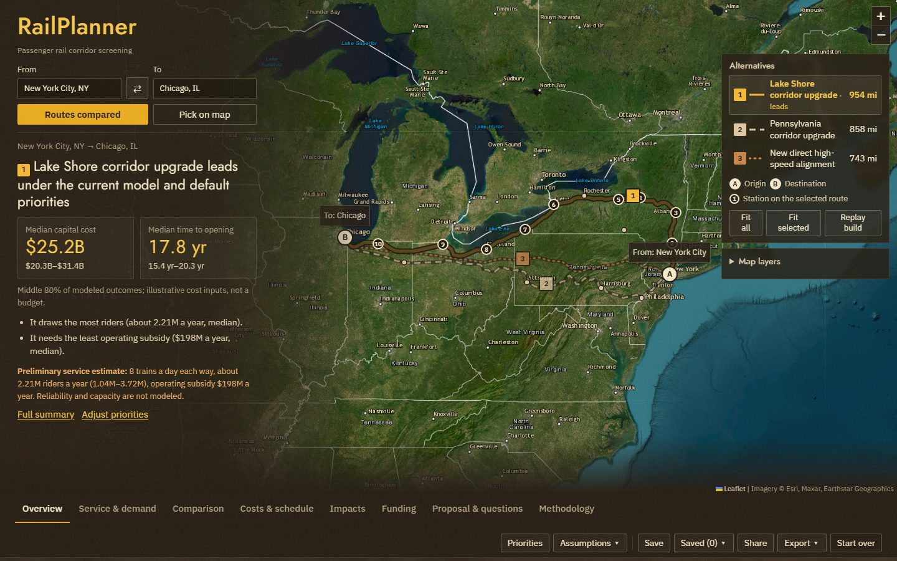
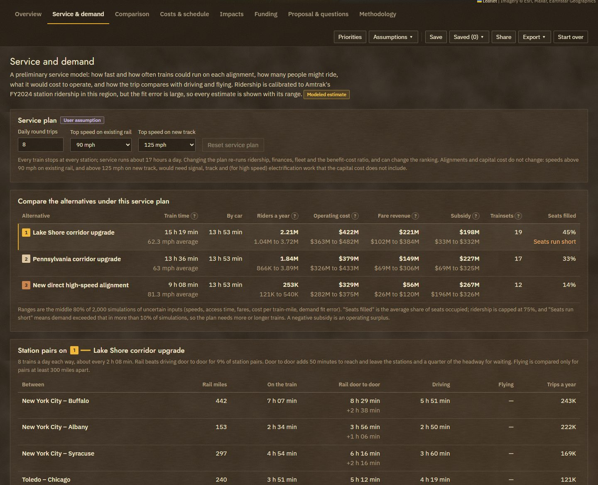
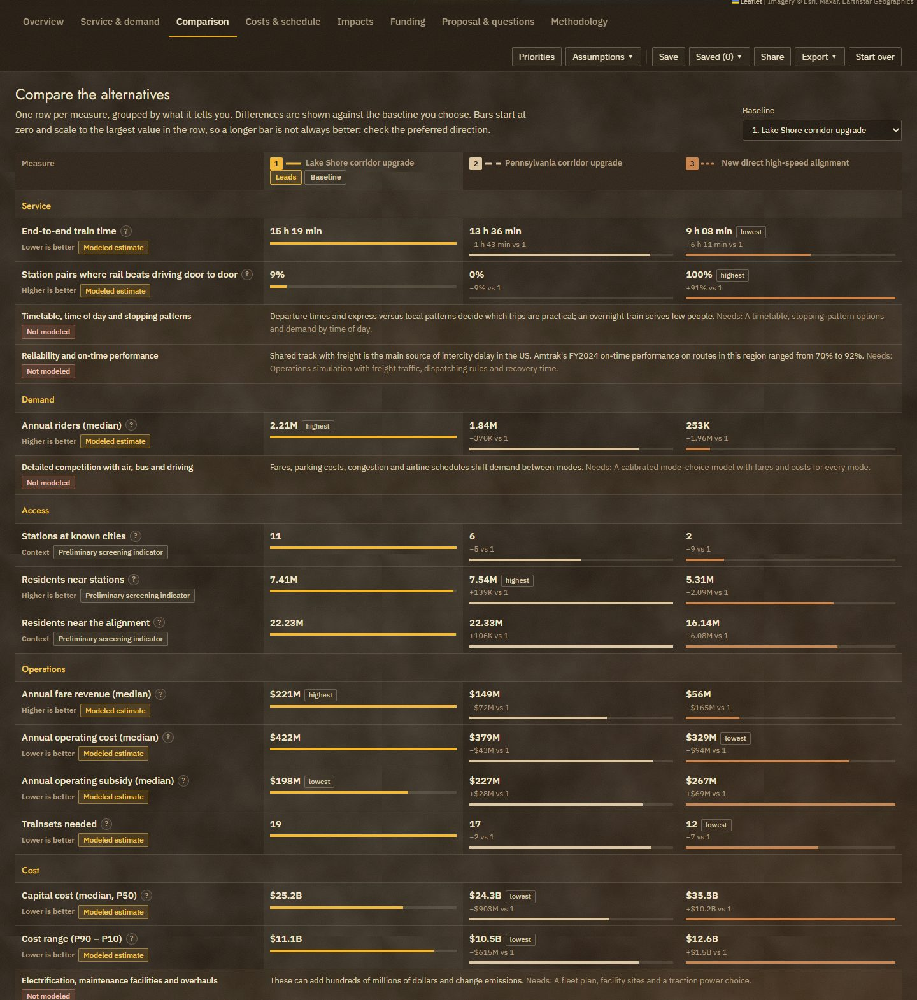
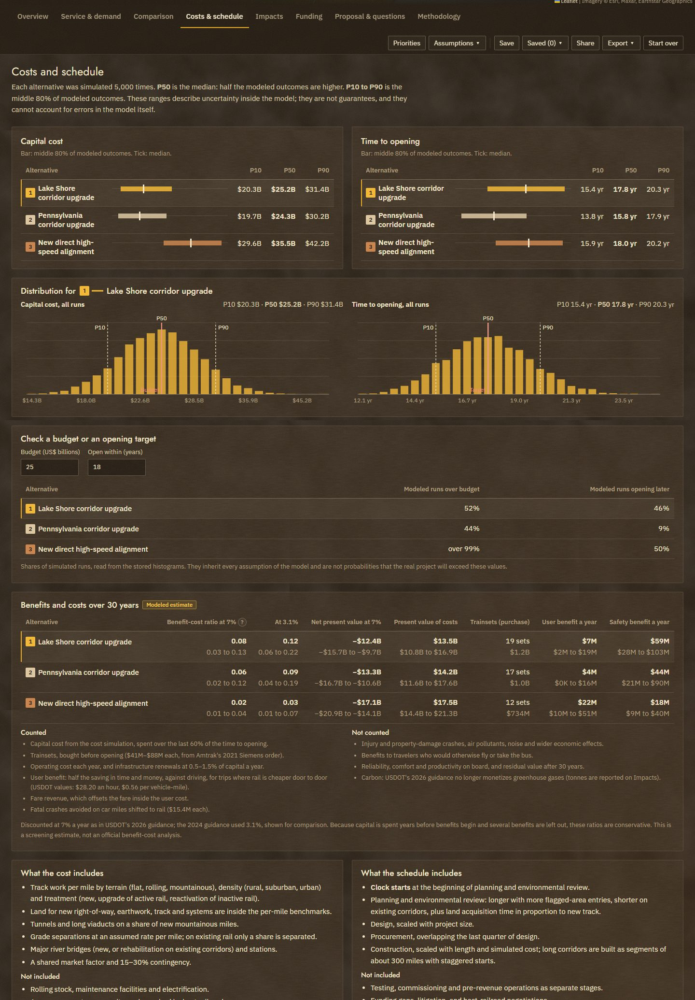

# RailPlanner

Decision support for planning new US passenger rail corridors. Built for **SBUHacks 2026**.

Pick two cities. RailPlanner generates three candidate alignments on real rail, terrain, population and
protected-land data, runs 5,000 Monte Carlo simulations of cost and schedule per alternative (stored in Tiger
Data), ranks them under priorities you can adjust, screens federal funding fit, and drafts a proposal with
Gemini that is checked so it cannot introduce numbers of its own.

It is a screening tool and says what it knows and does not: a preliminary service model estimates train
times, ridership (calibrated to Amtrak's FY2024 station ridership), operating cost and subsidy, fleet, CO2,
road safety and a benefit-cost ratio, each with its range; timetables, reliability and line capacity are still
not modeled. Every figure carries a status label.

**Live demo:** http://45.77.76.26 · New York → Chicago: http://45.77.76.26/?from=1&to=33

> **Illustrative estimates.** Cost benchmarks are placeholders bracketed by publicly reported US rail
> projects, not calibrated estimates. Floodplain flags are an approximate proxy. Every result says so in
> the UI and in the generated proposal.

---

## What it does

| Step | What happens | Where |
|---|---|---|
| Choose a corridor | Type an origin and destination (17 cities from New York to Chicago) in the map overlay, or pick two cities on the map | `frontend/src/components/Toolbar.tsx` |
| Generate alternatives | Least-cost paths on a 1 km grid with three strategies: upgrade existing rail, a new direct alignment, and a route via intermediate cities within a 25% detour (or named corridor templates for long routes, e.g. the Lake Shore vs Pennsylvania routes for NYC–Chicago) | `backend/app/routing.py` |
| Measure | Length, share on existing rail, new-track miles (and in mountainous terrain), stations in route order, residents near stations (10 km, counted once) and near the line (10 mi), flagged miles on new track, river crossings | `backend/app/scoring.py`, `frontend/src/metrics.ts` |
| Service and demand | For an editable service plan (daily round trips, top speeds): running times over each alignment's track profile; door-to-door times against driving and flying; ridership by station pair from a gravity model fitted to FY2024 Amtrak ridership at 12 stations (leave-one-out error shown); fare revenue and operating cost from Amtrak's FY2024 route results; trainsets; CO2 and road deaths avoided; a benefit-cost ratio with USDOT 2026 values (7%, with 3.1% as a sensitivity); share of the route on freight-owned and single track. Uncertain inputs are sampled 2,000 times and reported as P10/P50/P90 | `backend/app/service.py`, `backend/data/service_parameters.json`, `backend/data/observed_rail.json`, `backend/scripts/calibrate_demand.py` |
| Rank | Adjustable weights on capital cost, delivery, riders, train time, operating subsidy, new track in flagged areas, residents near stations and new right-of-way; the ranking, its explanation and the decision summary update live and travel with saved, shared and exported scenarios | `frontend/src/scoring.ts`, `frontend/src/summary.ts` |
| Simulate | 5,000 PERT/triangular Monte Carlo runs of capital cost and time to opening per alternative, bulk-loaded into a TimescaleDB hypertable; P10/P50/P90 and histograms are read back from a continuous aggregate | `backend/app/simulation.py`, `backend/sql/schema.sql` |
| Funding guide | Rule-based screening and qualitative fit against six federal programs (FSP-National, FSP-NEC, CRISI, BUILD, RRIF, Corridor ID). Each program lists applicants, stage, match, limits, round status, official source, verification date and a next step; assumed award sizes are labeled as RailPlanner assumptions and amounts are never summed | `backend/app/funding.py`, `backend/data/funding_programs.json` |
| Draft a proposal | Gemini writes the sections (service assumptions, alternatives and tradeoffs, a recommendation conditional on the active priorities, uncertainty, funding, risks and gaps, next steps) from a payload of pre-formatted figures; a number check rejects any figure not in the payload, retries once, then falls back to a template draft. A scenario record and source list are appended by code. Drafts can be edited, then downloaded as Markdown or saved as PDF | `backend/app/proposal.py` |
| Ask questions | Suggested questions are generated from the results with their premises checked. Answers are short by default (with optional detail), cite supporting measures, label anything outside the analysis and say when something is not modeled; same number check | `backend/app/proposal.py`, `frontend/src/summary.ts` |
| Save, share, export | Scenarios save in the browser and can be compared side by side with the current one; Share copies a link with corridor, selection, tab and weights; Export produces a PDF (print) or HTML report and a CSV of every measure, range, station, priority and ranking; Start over resets everything | `frontend/src/scenario.ts` |
| Sensitivity | For each priority, the weight range over which the current leader stays first, and who leads outside it | `frontend/src/scoring.ts` |
| Watch it built | A p5.js canvas lays the selected corridor's track mile by mile with a running mile count; on by default, with **Replay build** in the legend and a switch under **Map layers**; with reduced motion the finished track is drawn | `frontend/src/components/P5Overlay.tsx` |

### The workspace

The page opens on a full-width satellite map in an espresso, tan and gold theme. A semi-transparent gradient
overlay on the left holds the RailPlanner title, the From/To fields, **Compare routes** and **Pick on map**, and
a compact decision summary: which alternative leads under the current model and priorities, its median cost and
time to opening with ranges, two reasons, and the preliminary service estimate. A floating panel on the right
shows the legend (each alternative keeps one color, number and line pattern: gold solid, tan dashed, caramel
dotted), **Fit all / Fit selected / Replay build**, and the collapsible **Map layers** (satellite or plain
basemap, existing rail, protected areas, terrain, labels, animation).

A sticky bar under the map holds the tabs and the scenario actions (Priorities, Assumptions, Save, Saved,
Share, Export, Start over). Tabs: **Overview** (the full decision summary with riders and subsidy, open
questions and next step; stations in route order; alternative cards with what each gains and gives up),
**Service & demand** (the service plan, train times, ridership, finances and fleet for each alternative,
station pairs against driving and flying, the ridership fit against Amtrak data, and what is still not
modeled), **Comparison** (one grouped table with preferred direction, status, definitions on demand and
differences from a chosen baseline), **Costs & schedule** (P10/P50/P90 explained, histograms, budget and
opening-date checks, benefits and costs over 30 years, what the estimates include and exclude), **Impacts**
(track treatment, flagged areas, CO2 and road safety), **Funding**, **Proposal & questions** (suggested
questions generated from the results), and **Methodology** (status labels; priorities with sensitivity; every
measure's definition, units, source, data year, coverage, method, key assumptions, uncertainty and known
limitations; every service-model input with its source; model assumptions and data sources).

Status labels used throughout: Observed, User assumption, Modeled estimate, Preliminary screening indicator,
Not modeled, Not available. A value that is missing is shown as Not available and excluded from rankings, so
missing data can never make an alternative look better. There are no numerical confidence scores, because
there is no defensible method to derive them from these inputs.

On phones the map stays at the top and the overlay and legend stack beneath it; the corridor fields fold into
a one-line bar once results are shown, and the comparison table keeps its first column in view. Results, errors and loading time are announced to screen
readers, and every failure keeps your inputs and offers a retry.

## Architecture



### Request flow for `POST /plan`

1. Return the latest stored plan for the pair from Tiger, if any (`?fresh=true` forces a recompute).
2. If Tiger is unreachable, serve the committed JSON demo cache for the four demo corridors.
3. Otherwise compute: routes → scores → Monte Carlo (written to the hypertable) → summaries read back from the
   continuous aggregate → funding matches, all persisted. If Tiger fails mid-way, summaries are computed in
   process with identical binning, so the response shape never changes.
4. Service, demand and benefit-cost estimates are attached to every plan, stored or new, for the default
   service plan. `POST /service` re-runs them for another plan (daily round trips, top speeds) without
   changing alignments or capital cost; `GET /service-parameters` returns every input with its source and the
   demand calibration.

### Guardrails on the language model

- Gemini only ever sees figures we computed, already formatted (`"$24.3B"`, `"15.8 years"`, `"858 miles"`).
- It returns sections as structured JSON; headings and the "Illustrative estimates" disclaimer are added by us.
- `number_check()` extracts every figure from the output and requires each to appear in the payload. One retry
  names the offending figures; if it still fails, or Gemini is overloaded (503/429), a deterministic template
  draft built only from payload strings is returned instead. The UI shows which source produced the draft.

## Data

All public, no keys. `backend/scripts/prepare_data.py` downloads, caches (`backend/data/raw/`, gitignored) and
builds `backend/data/processed/grid.npz` (6 MB, committed) for the region from New York City and Philadelphia
to Chicago.

| Layer | Source | Status |
|---|---|---|
| Rail lines (active/inactive, passenger) | BTS NTAD North American Rail Network Lines | real |
| Population and US land mask | Census TIGERweb 2020 tracts (POP100) | real |
| Terrain slope | USGS 3DEP elevation, 250 m → 1 km mean/max slope | real |
| Lakes, rivers, ocean | Natural Earth 10m + DEM | real (coarse) |
| Protected areas, wildlife refuges | USGS PAD-US 3.0, GAP status 1–2, ≥1,000 acres | real |
| Floodplain | River corridors + hand-digitized NY river outlines | approximate proxy |
| Cost benchmarks | `backend/data/cost_benchmarks.csv` | illustrative placeholders |
| Funding programs | `backend/data/funding_programs.json`, checked against FRA and USDOT program pages | verified 2026-10-24 (RRIF, Corridor ID partly) |
| Station ridership, schedules | Amtrak FY2024 state fact sheets; Empire Service, Keystone/Pennsylvanian and Lake Shore Limited timetables (`backend/data/observed_rail.json`) | real (FY2024) |
| Fares and operating cost | Amtrak Monthly Performance Report, September 2024 (FY2024 route ticket revenue, operating expense, passenger-miles, train-miles) | real, derived ratios |
| Trainset cost | Amtrak's 2021 Siemens order ($3.4B for up to 83 trainsets; $7.3B program) | real, derived range |
| Benefit-cost values | USDOT Benefit-Cost Analysis Guidance, 2026 update (time, vehicle cost, occupancy, fatal crash, 7% discount) | real |
| Emissions and safety | EPA (car and diesel CO2), ORNL Transportation Energy Data Book (Amtrak energy), EIA (diesel heat content), NHTSA 2023 (fatality rate) | real |
| Service assumptions | Speeds, access time, frequency elasticity and others in `backend/data/service_parameters.json` | assumptions, with ranges |

## Setup

### Prerequisites

- Python 3.11+ (developed on 3.14), Node 20+
- A [Tiger Data](https://www.tigerdata.com/) service (TimescaleDB; PostGIS is enabled automatically if available)
- A Gemini API key from Google AI Studio (optional: without it, proposals fall back to the template draft and Q&A is disabled)

### Environment variables (`.env` at the repo root; copy `.env.example`)

| Variable | Required | Purpose |
|---|---|---|
| `DATABASE_URL` | yes | Tiger Data service URL, including the password (`postgres://tsdbadmin:…@….tsdb.cloud.timescale.com:PORT/tsdb?sslmode=require`) |
| `GEMINI_API_KEY` | for proposals/Q&A | Google AI Studio key |
| `GEMINI_MODEL` | no | Default `gemini-3.5-flash` (falls back to `gemini-flash-latest`) |
| `ELEVENLABS_API_KEY`, `ELEVENLABS_VOICE_ID` | no | Voice narration (not built yet; the Listen button stays hidden without a key) |
| `CORS_ORIGINS` | no | Comma-separated allowed origins, e.g. `http://localhost:5173,http://45.77.76.26` |
| `SIM_RUNS` | no | Monte Carlo runs per alternative (default 5000) |
| `USE_DEMO_CACHE` | no | Serve committed demo results when Tiger is unreachable (default `true`) |
| `SITE_ADDRESS` | no | Caddy site address: `:80` for plain HTTP on an IP, or a domain for automatic HTTPS |

### Local development

```bash
cp .env.example .env        # then fill in DATABASE_URL and GEMINI_API_KEY

cd backend
python -m venv ~/.venvs/railplanner          # on Windows keep the venv at a short path (MAX_PATH)
~/.venvs/railplanner/Scripts/python -m pip install -r requirements.txt   # bin/ instead of Scripts/ on macOS/Linux
~/.venvs/railplanner/Scripts/python -m app.db migrate                    # schema, hypertable, continuous aggregate, cities
~/.venvs/railplanner/Scripts/python -m uvicorn app.main:app --reload --port 8000

cd ../frontend
npm install
npm run dev                 # http://localhost:5173, proxies /api to :8000
```

### Data and demo cache (optional; the outputs are committed)

```bash
cd backend
pip install -r requirements-data.txt
python -m scripts.prepare_data                       # rebuild grid.npz from the public sources
python -m scripts.precompute_demo                    # recompute the 4 demo corridors into Tiger + JSON cache
python -m scripts.precompute_demo --proposals-only   # draft and cache Gemini proposals for them
python -m scripts.calibrate_demand                   # refit the ridership model to observed_rail.json
python -m scripts.plot_routes "New York City" Chicago   # route map to docs/img/
```

### Tests

```bash
cd backend && python -m pytest -q     # 46 tests; Gemini is mocked. Tests that use Tiger Data or the demo
                                      # cache need the database reachable and current demo caches
```

## Deployment (Vultr, Docker Compose)

```bash
ssh root@HOST 'bash -s' < deploy/setup-server.sh      # once: Docker + Compose, swap, firewall 22/80/443
scp .env root@HOST:/opt/railplanner/app/.env           # once: then set CORS_ORIGINS and SITE_ADDRESS on the server
DEPLOY_HOST=root@HOST deploy/deploy.sh                 # every release: ships HEAD, rebuilds, prints /api/health
```

The stack is three containers: `api` (FastAPI; runs the idempotent migration on start), `frontend`
(nginx serving the Vite build) and `proxy` (Caddy: `/api/*` → api, everything else → frontend). Only port 80
is published by default: on a bare IP an open-but-certificate-less 443 makes Chrome's automatic HTTPS upgrade
fail. Set `SITE_ADDRESS` to a domain that points at the VM and `deploy.sh` adds `docker-compose.https.yml`
(port 443), and Caddy obtains the certificate automatically.

Deploying needs outbound SSH (port 22), and Tiger Data uses a non-standard port; some networks block both.
After a release that changes `MODEL_VERSION`, rebuild the demo caches and run the full tests on the server,
where the database is reachable, in a throwaway container from the API image:

```bash
ssh root@HOST 'cd /opt/railplanner/app && docker run --rm --env-file .env -v "$PWD/backend:/srv" -w /srv app-api \
  sh -c "pip install -q pytest httpx && python -m scripts.precompute_demo && python -m pytest -q"'
scp 'root@HOST:/opt/railplanner/app/backend/data/demo_cache/*.json' backend/data/demo_cache/   # then commit
```

## Demo script (about 3 minutes)

1. **Open** http://45.77.76.26. "RailPlanner helps a state DOT compare passenger rail alternatives before
   spending money on a study."
2. **Type New York City → Chicago** and click **Compare routes**. Read the Overview: which alternative leads
   under the current model and priorities, its median cost and opening time with ranges, why it leads, the
   main tradeoff, and the preliminary riders and operating subsidy, while the track is laid mile by mile.
3. **Click another alternative** on the map or in the legend. Selection follows across every tab; "Leads" and
   "Selected" are marked separately.
4. **Service & demand.** Change trains per day or top speed: ridership, operating cost, subsidy, fleet and
   the benefit-cost ratio re-run, and the fit table shows how the ridership model compares with Amtrak's
   FY2024 station ridership.
5. **Priorities.** Move "More riders" or "Lower operating subsidy": the ranking and summary update and the
   panel explains why the leader changed.
6. **Comparison.** "One table, grouped by what each measure tells you, with the preferred direction and how
   each figure was produced. Rows we can't estimate yet say so."
7. **Costs & schedule.** "Each alternative is 5,000 Monte Carlo runs stored in a Tiger Data hypertable; the
   P10/P50/P90 ranges and histograms come from a TimescaleDB continuous aggregate." Enter a budget to see
   the share of runs above it, then the 30-year benefits and costs.
8. **Funding**, then **Proposal & questions**: generate the draft (number check passes) and click a
   suggested question.
9. **Share** or **Export report** to hand the scenario, with its weights, to someone else.
10. **Close:** "Every figure here is illustrative, and the tool says so. The point is a fast, honest
   comparison before a $500K Corridor ID study, not a replacement for it."

**Backup path:** the demo corridors and their proposals are cached in Tiger and in `backend/data/demo_cache/`,
so steps 2–8 need no live computation or Gemini call. Q&A is the only step that needs Gemini live; if it is
busy, the panel says so.

## Screenshots

New York → Chicago at 1440 px wide, captured with headless Edge.

**Map and overlay:** the full-width map with the corridor controls and compact decision summary on the
gradient overlay, and the legend and map controls at the right.



**Service & demand:** the service plan, each alternative's train time, riders, operating cost, revenue,
subsidy and fleet with ranges, and the busiest station pairs against driving and flying.



**Comparison:** one grouped table with preferred direction, how each figure was produced, differences from a
chosen baseline, and rows for decision-critical measures that are not modeled yet.



**Costs & schedule:** P10/P50/P90 explained, ranges for all three alternatives, the 5,000-run histograms
from the TimescaleDB continuous aggregate, budget and opening-date checks, benefits and costs over 30 years,
and what the estimates include.



Route maps generated by `scripts/plot_routes.py` (hillshade, existing rail, protected areas, candidates):


## Acceptance criteria

- [x] `docker compose up` brings up a working app (running on the Vultr VM)
- [x] Albany → Buffalo returns three visibly different routes on the map
- [x] Each route shows cost and schedule P10/P50/P90 and histograms sourced from Tiger Data
- [x] Funding panel shows at least three matched programs with rationale
- [x] Proposal generates from computed data and the number check passes
- [ ] Voice narration plays (Phase 8, ElevenLabs: skipped for now)
- [x] A cached demo path works with no external API calls beyond the database (map imagery tiles still load from Esri)
- [x] README documents setup, environment variables and the demo script

## Limitations

- Service estimates are preliminary. Running times use top speeds and an average-speed factor, not a train
  performance simulation; every train stops everywhere; there is no timetable, time-of-day pattern,
  reliability or line-capacity analysis. Ridership comes from a sketch gravity model fitted to 12 stations
  (in-sample error about a factor of 1.5, leave-one-out about 1.8), so its ranges are wide. The benefit-cost
  ratio leaves out injuries, pollutants, wider economic effects and residual value, and is conservative.
- Costs are illustrative: per-mile benchmarks are placeholders, not calibrated to any project. No cost year
  or escalation; rolling stock, facilities, electrification and host-railroad access payments are excluded.
- Being on an existing rail corridor does not imply access, spare capacity or track suitable for passenger
  service.
- Alignments are conceptual paths on a 1 km grid, not engineered designs; curvature, grades and station
  siting are not modeled.
- Floodplain flags are a proxy (river corridors), not FEMA flood maps.
- Long corridors use named templates (e.g. NYC–Chicago) because free-form routing over ~800 miles drifts;
  other long pairs fall back to free-form routing.
- Funding program facts were verified against FRA and USDOT pages on 2026-10-24 (RRIF and Corridor ID only
  partly); they change every funding round. Fit scores are fixed rules, not probabilities of award.
- Not built yet: required stops and editable stations (these need backend routing changes), fare scenarios,
  and editing cost benchmarks or schedule durations in the UI. The service plan (trains per day, top speeds)
  is editable; faster speeds do not add the signal, track or electrification work they would need to the
  capital cost.
- The study region is NYC/Philadelphia to Chicago; cities outside it are not routable.

## Roadmap

- **Real calibration:** fit cost distributions to FRA corridor studies and the Transit Costs Project
  database, by terrain, density and treatment.
- **Permitting module:** NEPA pathway prediction (CE / EA / EIS) from FEMA NFHL floodplains, NWI wetlands and
  Section 4(f) properties, with schedule risk per pathway.
- **Operations simulation:** timetables and stopping patterns, train performance by speed class, freight
  traffic, reliability and line capacity, replacing the screening indicators.
- **Better demand data:** station-pair ridership or mobile-device trip data, fares and a calibrated
  mode-choice model with air and bus, to narrow the ridership ranges.
- **Supply chain:** rail, ties and structural steel lead times and price indices as schedule and cost drivers.
- **Editable scenarios:** required stops, station choices, fares and user-set cost and schedule inputs.
- **Voice narration (Phase 8):** ElevenLabs reading the executive summary and Q&A answers, cached by text hash.
- **HTTPS and a domain** for the deployment.
- **More regions:** extend the grid nationally and add templates for other long corridors.
