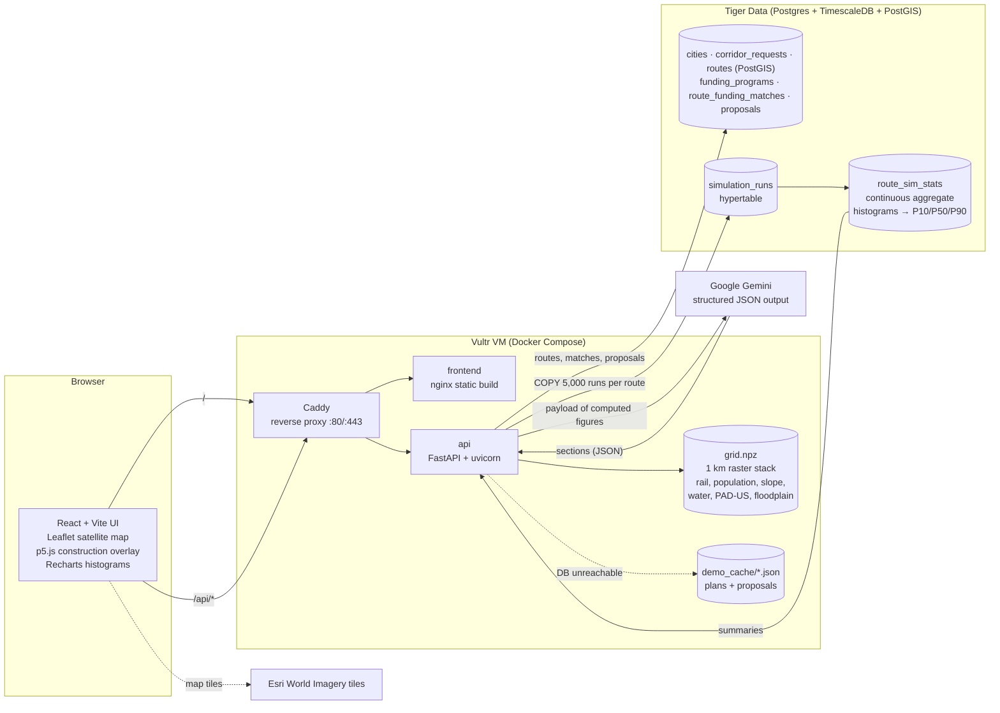
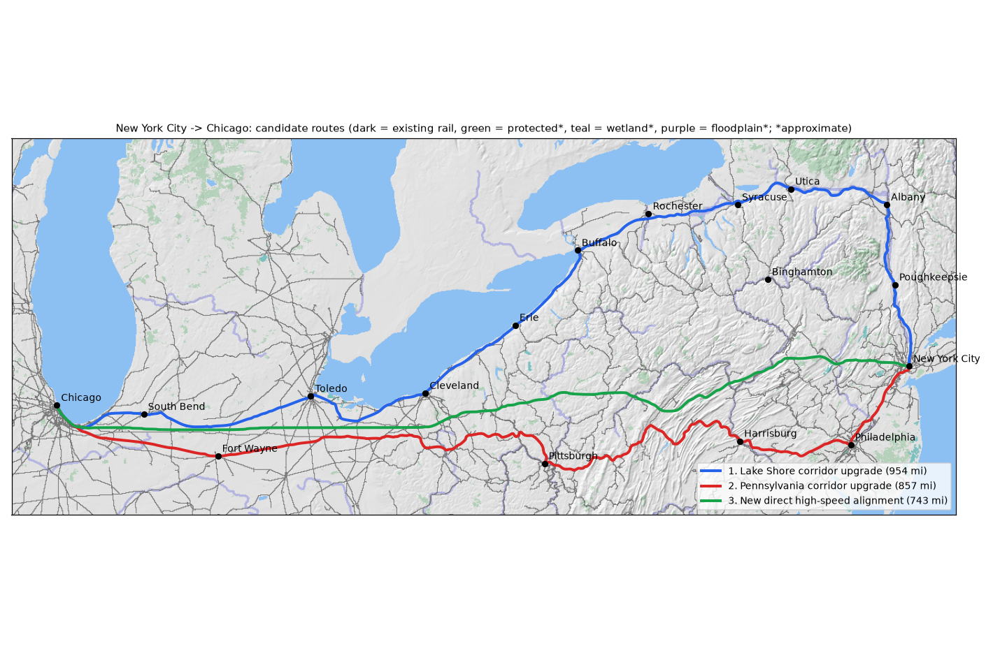

# RailPlanner

Decision support for planning new US passenger rail corridors. Built for **SBUHacks 2026**.

Pick two cities. RailPlanner generates three candidate alignments on real rail, terrain, population and
protected-land data, scores them, runs 5,000 Monte Carlo simulations of cost and schedule per alternative
(stored in Tiger Data), matches each one to federal funding programs, and drafts a proposal with Gemini that
is checked so it cannot introduce numbers of its own.

**Live demo:** http://45.77.76.26 · New York → Chicago: http://45.77.76.26/?from=1&to=33

> **Illustrative estimates.** Cost benchmarks are placeholders bracketed by publicly reported US rail
> projects, not calibrated estimates. Floodplain flags are an approximate proxy. Every result says so in
> the UI and in the generated proposal.

---

## What it does

| Step | What happens | Where |
|---|---|---|
| Choose a corridor | Pick an origin and destination (17 cities from New York to Chicago), or click two cities on the map | `frontend/src/App.tsx` |
| Generate alternatives | Least-cost paths on a 1 km grid with three strategies: upgrade existing rail, a new direct alignment, maximize population (or named corridor templates for long routes, e.g. the Lake Shore vs Pennsylvania routes for NYC–Chicago) | `backend/app/routing.py` |
| Score | Length, population within 10 mi, % on existing rail, terrain slope, environmental flags, river crossings → a documented 0–100 composite | `backend/app/scoring.py` |
| Simulate | 5,000 PERT/triangular Monte Carlo runs of capital cost and time to opening per alternative, bulk-loaded into a TimescaleDB hypertable; P10/P50/P90 and histograms are read back from a continuous aggregate | `backend/app/simulation.py`, `backend/sql/schema.sql` |
| Match funding | Rule-based fit against six federal programs (FSP-National, FSP-NEC, CRISI, BUILD, RRIF, Corridor ID) with federal/non-federal split at the median cost | `backend/app/funding.py` |
| Draft a proposal | Gemini writes the six required sections from a payload of pre-formatted figures; a number check rejects any figure not in the payload, retries once, then falls back to a template draft | `backend/app/proposal.py` |
| Ask questions | Gemini answers questions about the results under the same number check | `backend/app/proposal.py` |
| Watch it built | A p5.js canvas over the satellite map lays the active corridor's track mile by mile | `frontend/src/components/P5Overlay.tsx` |

## Architecture



### Request flow for `POST /plan`

1. Return the latest stored plan for the pair from Tiger, if any (`?fresh=true` forces a recompute).
2. If Tiger is unreachable, serve the committed JSON demo cache for the four demo corridors.
3. Otherwise compute: routes → scores → Monte Carlo (written to the hypertable) → summaries read back from the
   continuous aggregate → funding matches, all persisted. If Tiger fails mid-way, summaries are computed in
   process with identical binning, so the response shape never changes.

### Guardrails on the language model

- Gemini only ever sees figures we computed, already formatted (`"$24.3B"`, `"15.8 years"`, `"858 miles"`).
- It returns sections as structured JSON; headings and the "Illustrative estimates" disclaimer are added by us.
- `number_check()` extracts every figure from the output and requires each to appear in the payload. One retry
  names the offending figures; if it still fails, or Gemini is overloaded (503/429), a deterministic template
  draft built only from payload strings is returned instead. The UI shows which source produced the draft.

## Data

All public, no keys. `backend/scripts/prepare_data.py` downloads, caches (`backend/data/raw/`, gitignored) and
builds `backend/data/processed/grid.npz` (6 MB, committed) for the region from New York City and Philadelphia
to Chicago.

| Layer | Source | Status |
|---|---|---|
| Rail lines (active/inactive, passenger) | BTS NTAD North American Rail Network Lines | real |
| Population and US land mask | Census TIGERweb 2020 tracts (POP100) | real |
| Terrain slope | USGS 3DEP elevation, 250 m → 1 km mean/max slope | real |
| Lakes, rivers, ocean | Natural Earth 10m + DEM | real (coarse) |
| Protected areas, wildlife refuges | USGS PAD-US 3.0, GAP status 1–2, ≥1,000 acres | real |
| Floodplain | River corridors + hand-digitized NY river outlines | approximate proxy |
| Cost benchmarks | `backend/data/cost_benchmarks.csv` | illustrative placeholders |
| Funding programs | `backend/data/funding_programs.json` | approximate |

## Setup

### Prerequisites

- Python 3.11+ (developed on 3.14), Node 20+
- A [Tiger Data](https://www.tigerdata.com/) service (TimescaleDB; PostGIS is enabled automatically if available)
- A Gemini API key from Google AI Studio (optional: without it, proposals fall back to the template draft and Q&A is disabled)

### Environment variables (`.env` at the repo root; copy `.env.example`)

| Variable | Required | Purpose |
|---|---|---|
| `DATABASE_URL` | yes | Tiger Data service URL, including the password (`postgres://tsdbadmin:…@….tsdb.cloud.timescale.com:PORT/tsdb?sslmode=require`) |
| `GEMINI_API_KEY` | for proposals/Q&A | Google AI Studio key |
| `GEMINI_MODEL` | no | Default `gemini-3.5-flash` (falls back to `gemini-flash-latest`) |
| `ELEVENLABS_API_KEY`, `ELEVENLABS_VOICE_ID` | no | Voice narration (not built yet; the Listen button stays hidden without a key) |
| `CORS_ORIGINS` | no | Comma-separated allowed origins, e.g. `http://localhost:5173,http://45.77.76.26` |
| `SIM_RUNS` | no | Monte Carlo runs per alternative (default 5000) |
| `USE_DEMO_CACHE` | no | Serve committed demo results when Tiger is unreachable (default `true`) |
| `SITE_ADDRESS` | no | Caddy site address: `:80` for plain HTTP on an IP, or a domain for automatic HTTPS |

### Local development

```bash
cp .env.example .env        # then fill in DATABASE_URL and GEMINI_API_KEY

cd backend
python -m venv ~/.venvs/railplanner          # on Windows keep the venv at a short path (MAX_PATH)
~/.venvs/railplanner/Scripts/python -m pip install -r requirements.txt   # bin/ instead of Scripts/ on macOS/Linux
~/.venvs/railplanner/Scripts/python -m app.db migrate                    # schema, hypertable, continuous aggregate, cities
~/.venvs/railplanner/Scripts/python -m uvicorn app.main:app --reload --port 8000

cd ../frontend
npm install
npm run dev                 # http://localhost:5173, proxies /api to :8000
```

### Data and demo cache (optional; the outputs are committed)

```bash
cd backend
pip install -r requirements-data.txt
python -m scripts.prepare_data                       # rebuild grid.npz from the public sources
python -m scripts.precompute_demo                    # recompute the 4 demo corridors into Tiger + JSON cache
python -m scripts.precompute_demo --proposals-only   # draft and cache Gemini proposals for them
python -m scripts.plot_routes "New York City" Chicago   # route map to docs/img/
```

### Tests

```bash
cd backend && python -m pytest -q     # 35 tests; the DB round trip is skipped without DATABASE_URL, Gemini is mocked
```

## Deployment (Vultr, Docker Compose)

```bash
ssh root@HOST 'bash -s' < deploy/setup-server.sh      # once: Docker + Compose, swap, firewall 22/80/443
scp .env root@HOST:/opt/railplanner/app/.env           # once: then set CORS_ORIGINS and SITE_ADDRESS on the server
DEPLOY_HOST=root@HOST deploy/deploy.sh                 # every release: ships HEAD, rebuilds, prints /api/health
```

The stack is three containers: `api` (FastAPI; runs the idempotent migration on start), `frontend`
(nginx serving the Vite build) and `proxy` (Caddy: `/api/*` → api, everything else → frontend). Only port 80
is published by default: on a bare IP an open-but-certificate-less 443 makes Chrome's automatic HTTPS upgrade
fail. Set `SITE_ADDRESS` to a domain that points at the VM and `deploy.sh` adds `docker-compose.https.yml`
(port 443), and Caddy obtains the certificate automatically.

## Demo script (about 3 minutes)

1. **Open** http://45.77.76.26. "RailPlanner helps a state DOT compare passenger rail alternatives before
   spending money on a study."
2. **Choose New York City → Chicago** and click **Plan corridor**. While the track is laid mile by mile:
   "Three alternatives: upgrade the Lake Shore route, upgrade the Pennsylvania route, or build a new direct
   line. They're routed on real rail, terrain, population and protected-land data."
3. **Click route 2 (Pennsylvania)** in the Routes list. The construction restarts on that alignment. Read the
   summary: highest score, lowest median cost, shortest schedule.
4. **Scroll to Comparison.** "Every row has a bar; 'best' marks the leader. The direct line is shortest but
   needs new right-of-way, so it costs more."
5. **Cost and schedule uncertainty.** "These aren't single numbers. Each alternative is 5,000 Monte Carlo runs
   stored in a Tiger Data hypertable; the P10/P50/P90 ranges and histograms come straight from a TimescaleDB
   continuous aggregate."
6. **Funding.** Open the FSP-National row: "Its typical award covers only a slice of this cost, so the
   tool flags phasing and the need for a multi-state sponsor." Point out the NEC eligibility on the
   Pennsylvania route's New York–Philadelphia segment.
7. **Generate proposal.** "Gemini drafts the proposal, but it can't invent numbers: every figure is checked
   against our computed results." Point at the green number-check line.
8. **Ask a question**, e.g. "Why does the direct alignment take longer to open even though it is shorter?"
9. **Close:** "Every figure here is illustrative, and the tool says so. The point is a fast, honest
   comparison before a $500K Corridor ID study, not a replacement for it."

**Backup path:** the demo corridors and their proposals are cached in Tiger and in `backend/data/demo_cache/`,
so steps 2–7 need no live computation or Gemini call. Q&A is the only step that needs Gemini live; if it is
busy, the panel says so.

## Screenshots

| | |
|---|---|
|  |  |
| _Slot: planner view with the construction animation (add `docs/img/screenshot-planner.png`)_ | _Slot: alternatives and comparison table (add `docs/img/screenshot-comparison.png`)_ |
|  |  |
| _Slot: cost and schedule uncertainty (add `docs/img/screenshot-uncertainty.png`)_ | _Slot: Gemini proposal with the number check (add `docs/img/screenshot-proposal.png`)_ |

Route maps generated by `scripts/plot_routes.py` (hillshade, existing rail, protected areas, candidates):



## Acceptance criteria

- [x] `docker compose up` brings up a working app (running on the Vultr VM)
- [x] Albany → Buffalo returns three visibly different routes on the map
- [x] Each route shows cost and schedule P10/P50/P90 and histograms sourced from Tiger Data
- [x] Funding panel shows at least three matched programs with rationale
- [x] Proposal generates from computed data and the number check passes
- [ ] Voice narration plays (Phase 8, ElevenLabs: skipped for now)
- [x] A cached demo path works with no external API calls beyond the database (map imagery tiles still load from Esri)
- [x] README documents setup, environment variables and the demo script

## Limitations

- Costs are illustrative: per-mile benchmarks are placeholders, not calibrated to any project.
- Alignments are conceptual paths on a 1 km grid, not engineered designs; curvature, grades and station
  siting are not modeled.
- Floodplain flags are a proxy (river corridors), not FEMA flood maps.
- Long corridors use named templates (e.g. NYC–Chicago) because free-form routing over ~800 miles drifts;
  other long pairs fall back to free-form routing.
- Funding program parameters are approximate and change every funding round.
- The study region is NYC/Philadelphia to Chicago; cities outside it are not routable.

## Roadmap

- **Real calibration:** fit cost distributions to FRA corridor studies and the Transit Costs Project
  database, by terrain, density and treatment.
- **Permitting module:** NEPA pathway prediction (CE / EA / EIS) from FEMA NFHL floodplains, NWI wetlands and
  Section 4(f) properties, with schedule risk per pathway.
- **Operations simulation:** timetables, running times by alignment and speed class, ridership and farebox
  estimates feeding back into funding (RRIF repayment capacity).
- **Supply chain:** rail, ties and structural steel lead times and price indices as schedule and cost drivers.
- **Voice narration (Phase 8):** ElevenLabs reading the executive summary and Q&A answers, cached by text hash.
- **HTTPS and a domain** for the deployment.
- **More regions:** extend the grid nationally and add templates for other long corridors.
